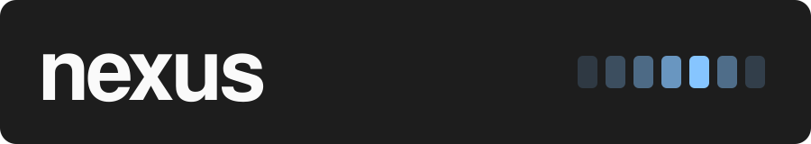

# 

**Talk to your AIs in one keyboard-driven window on your Mac.** Press ⌘ and the backtick key from any app. Your conversations are right there.

## What you get

- **One tab per friend.** Work with Claude on a change, then switch to Codex for a second opinion. Each keeps its own conversation and workspace.
- **The same controls across harnesses.** Use `/model` and `/effort` to choose how a friend works. Type `/info` to see the account, model and working directories.
- **Room to finish a thought.** Stack messages with Enter and send them together. Close the overlay while your friends work. The server keeps going.
- **A setup your AI can change with you.** Configure friends in nova-config. Tune shortcuts, tabs, colors and sounds in Starlark and JSON.

Built for Apple silicon on macOS 26 or newer. Bring a supported subscription and a machine to run the server. The same Mac can do both.

**[Read the setup guide](docs/README.md)** · [Customize your client](docs/policy.md) · [Supported harnesses](drivers/rpc/README.md)
